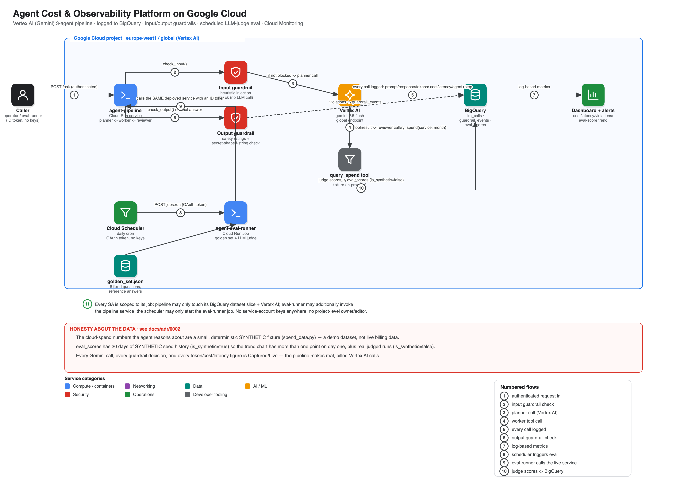

# Agent Cost & Observability Platform on Google Cloud

An **observability and cost-governance platform for LLM agent workloads** on Vertex AI:
a real 3-agent (planner → tool-using worker → reviewer) Gemini pipeline on Cloud Run,
every call logged to BigQuery with token counts, computed cost, latency and agent/step
identity, input/output guardrails against prompt injection and data exfiltration, and a
scheduled golden-set evaluation scored by an LLM-as-judge — all provisioned and
destroyed by **one script each**. It is the token/quality/safety complement to this
project's sibling repo, `gcp-finops-cost-anomaly-detector`, which covers infra/cloud
spend rather than LLM spend.

> **Status: deployed and verified live** (europe-west1 / Vertex AI global endpoint,
> 2026-09-27). A from-scratch `./scripts/down.sh` followed immediately by
> `./scripts/up.sh` built the whole stack with no manual steps and
> [`scripts/test.sh`](scripts/test.sh) passed **18 of 18**
> ([results](docs/test-results.md)), including a real end-to-end question answered
> correctly against the synthetic spend fixture, a real prompt-injection attempt blocked
> before any Gemini call, and a real golden-set run scored 5/5/5 on every question by the
> LLM judge. Getting there took **eight real bugs** that only a live deployment found —
> each documented with root cause and fix in
> [runbook 03](docs/runbooks/03-troubleshooting.md) (a quota-project gotcha, log-metric
> label mismatches, a DISTRIBUTION-vs-scalar alert-policy restriction, Google's front end
> silently reserving `/healthz`, two Vertex AI SDK host/version bugs, human-vs-service-account
> ID token audience rules, and log-based-metric propagation lag). The stack was then
> removed with `./scripts/down.sh` — nothing billable left running (confirmed below).

```bash
gcloud config set project <your-project>      # billing linked; the rest is auto-detected
./scripts/up.sh       # infra -> build both images -> deploy service+job+scheduler -> seed synthetic history -> run golden set -> live tests
./scripts/down.sh     # delete everything (--purge also drops the Terraform state)
```

## What it proves

| Concern | Mechanism | Proven by |
|---|---|---|
| **Every LLM call is accounted for** | A logging middleware wraps every Gemini call: prompt, response, input/output/thinking tokens, cost (published Vertex AI pricing), latency, agent/step identity → BigQuery `llm_calls` | test §2-3: a real `/ask` call produces ≥3 logged rows with nonzero cost |
| **Prompt injection is caught before it costs anything** | A heuristic input guardrail runs before any Gemini call; a match blocks the request with zero Vertex AI spend | test §4: a canonical injection attempt is blocked at the input stage with 0 logged Gemini calls |
| **Unsafe/exfiltration-shaped output is caught too** | Output guardrail checks Vertex AI safety ratings + an explicit secret-shaped-string rubric on the final answer | unit tests (`app/pipeline/tests/test_guardrails.py`); [threat model](docs/threat-model.md) T6 |
| **Quality is measured, not assumed** | A Cloud Run Job runs a fixed 8-question golden set against the *deployed* service and scores each answer with an LLM-as-judge, writing to BigQuery `eval_scores` over time | test §7: a real run scored all 8 questions 5/5/5, `is_synthetic=false` |
| **Synthetic history is never blurred with real data** | 20 days of clearly-labelled `is_synthetic=true` seed rows give the trend chart history on day one; every live-judged run is `is_synthetic=false` | [ADR 0002](docs/adr/0002-synthetic-seed-data-for-eval-history.md); test §7 asserts `is_synthetic` is never NULL |
| **Cost/latency/violations/quality are all watchable in one place** | Cloud Monitoring dashboard built from log-based metrics; two alert policies (cost spike, guardrail-violation rate) | test §8 |
| **Least privilege, no keys** | Four dedicated service accounts, each scoped to one job; no project-level owner/editor; no service-account keys anywhere | test §5-6 |
| **The whole thing is reproducible** | One script builds it, one tears it down | `scripts/up.sh` / `down.sh` |

## Architecture

[](docs/img/architecture.svg)

<sub>Click for the vector version. Numbered steps trace the request and evaluation paths; the legend under the diagram explains each one. Diagram source: [`docs/diagrams/architecture.py`](docs/diagrams/architecture.py).</sub>

More: [architecture](docs/architecture.md) · [threat model](docs/threat-model.md)

## Design decisions

| ADR | Decision | Trade-off called out |
|---|---|---|
| [0001](docs/adr/0001-gemini-2.5-flash-global-endpoint.md) | `gemini-2.5-flash` on the global endpoint, verified live before writing any pipeline code | Weaker reasoning than a pro-tier model; mitigated structurally (the reviewer compares against tool ground truth rather than re-deriving answers) |
| [0002](docs/adr/0002-synthetic-seed-data-for-eval-history.md) | Synthetic fixture for the agent's task data + synthetic seed history for the eval trend chart | Proves the *method*, not a genuine multi-week quality trend |
| [0003](docs/adr/0003-heuristic-input-guardrail.md) | Heuristic (regex) input guardrail, not an LLM classifier | Limited to known injection phrasings; the output guardrail is the backstop |
| [0004](docs/adr/0004-threshold-alerts-not-trailing-baseline.md) | Threshold alert policies, not a trailing z-score baseline | No adaptive baseline; a single session has no history to build one from |
| [0005](docs/adr/0005-no-live-deploy-ci.md) | No GitHub-Actions WIF; CI is lint/validate/scan only | CI never touches the live project — by design, not oversight |
| [0006](docs/adr/0006-authenticated-service-and-job-not-function.md) | Authenticated-only Cloud Run service; a Job (not a Function) for evaluation | Requires an ID token to demo, not a bare public URL — deliberately |

[Threat model](docs/threat-model.md) maps every STRIDE threat to a control **and the test that proves it**, with particular attention to prompt-injection and data-exfiltration-via-agent.

## Runbooks

[docs/runbooks](docs/runbooks/README.md): build & teardown · running an evaluation · troubleshooting (all eight real bugs this build hit) · cost.

## Repository layout

```
terraform/    BigQuery (dataset + 3 tables), IAM (4 SAs), Cloud Run service + job,
              Scheduler, Monitoring (log metrics, dashboard, 2 alert policies), budget
app/pipeline/ FastAPI service: agents.py (planner/worker/reviewer), llm_client.py
              (logging middleware), guardrails.py, bigquery_logger.py, spend_data.py
              (synthetic fixture + tool), pricing.py (published Vertex AI rates)
app/judge/    run_golden_set.py (Cloud Run Job entrypoint) + judge.py (LLM-as-judge)
golden_set/   golden_set.json — 8 fixed questions with reference answers
seed/         generate_synthetic_eval_history.py — SYNTHETIC eval-score backfill
scripts/      up.sh · down.sh · test.sh · bootstrap.sh · lib.sh
docs/         architecture · threat model · ADRs · runbooks · diagrams · test-results.md
```

## Cost & safety

Well under $0.01 in Vertex AI spend for a full build-test-teardown session: `gemini-2.5-flash`
is billed at $0.30/1M input and $2.50/1M output tokens, and one `/ask` call plus one
8-question golden-set run totals a few thousand tokens (see
[runbook 04](docs/runbooks/04-cost.md)). Cloud Run/BigQuery/Monitoring/Scheduler usage is
a rounding error against their free tiers, and a Terraform-managed Billing Budget bounds
total spend regardless. `down.sh` deletes the BigQuery dataset with its data and reports
0 across every category it checks — confirmed after the run behind this README's status
line: Cloud Run service/job, Scheduler job, BigQuery dataset, Artifact Registry, build
bucket, and all four `agent-*` service accounts.

## Known gaps (deliberate)

Golden-set evaluation quality is proven against 8 fixed questions over a small synthetic
fixture, not a large, evolving, human-reviewed benchmark — see
[ADR 0002](docs/adr/0002-synthetic-seed-data-for-eval-history.md) · the input guardrail is
a curated heuristic, not an ML classifier, so novel injection phrasings can slip through
to the output guardrail backstop ([ADR 0003](docs/adr/0003-heuristic-input-guardrail.md))
· alert policies are simple thresholds, not adaptive baselines
([ADR 0004](docs/adr/0004-threshold-alerts-not-trailing-baseline.md)) · no VPC Service
Controls perimeter around BigQuery · no rate limiting beyond Cloud Run's own concurrency
caps · indirect prompt injection via tool output and live exfiltration provocation are
not adversarially tested end-to-end (see [threat model](docs/threat-model.md) known gaps)
· no GitHub-Actions WIF for CI since CI never touches the live project
([ADR 0005](docs/adr/0005-no-live-deploy-ci.md)).

## License

MIT
